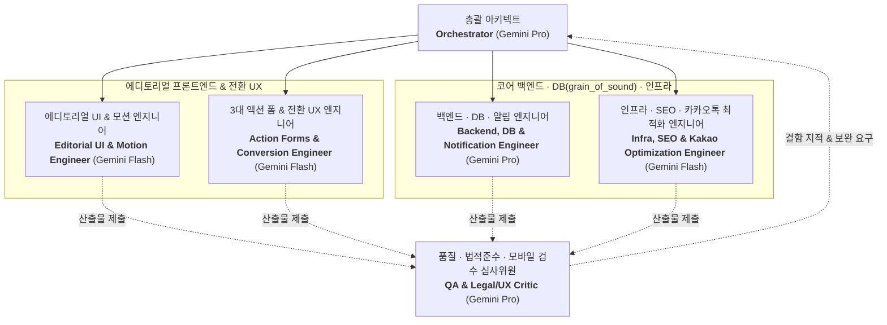

# 비영리 전통연희단체 「연희단 결 (GYEOL : The Grain of Sound)」 — 하네스 엔지니어링 헌장

- **프로젝트명**: 연희단 결 (GYEOL : The Grain of Sound) 공식 소개 및 섭외·모집 웹페이지 구축
- **기준 사양서**: [`docs/PRDs/gyeol.md`](file:///apps/ex_project_GrainofSound/docs/PRDs/gyeol.md) (비영리 전통연희단체 「연희단 결 (GYEOL : The Grain of Sound)」 공식 웹페이지 작업 지시서)
- **서비스 도메인 & 포트**: **`https://haetae.cocolabhub.com`** / 서비스 포트 **`3130`** (Node 디버그 인스펙터 포트: `3131`)
- **데이터베이스**: MongoDB 자체 운영 — 접속 DB명: **`grain_of_sound`** (`mongodb://.../grain_of_sound`)
- **성격**: 단체 브랜드 아이덴티티 대외 홍보('공식 얼굴'), 부천 관내 복지기관 및 지자체·대사관 공연 섭외 접수, 일반회원(연주 단원) 지원 및 후원회원(서포터즈) 가입 문의 유치를 위한 **Mobile-First 원페이지(One-Page) 스토리텔링 웹 + 3대 액션 접수·아카이브 백엔드**
- **확정 기술 스택**: React + Next.js (App Router) + TypeScript + Tailwind CSS + MongoDB (`grain_of_sound`) + 카카오톡 오픈채팅/SMTP/스프레드시트 알림 연동

---

## 1. 프로젝트 6대 절대 가드레일 (Strict Invariants)

모든 에이전트는 아래 6대 원칙을 절대적으로 준수하며, 위배되는 코드나 아키텍처를 작성하지 않는다:

1. **법적·운영적 가드레일 — 후원 계좌번호 및 직접 결제창 노출 절대 금지**:
   - 고유번호증만 보유한 비영리임의단체 기준에 맞추어, 불특정 다수를 대상으로 한 공개 모금으로 오인될 수 있는 **'후원 계좌번호' 텍스트나 '직접 후원금 결제 버튼/창'을 사이트 내 모든 영역(본문, 모달, 푸터)에 절대 노출하지 않는다** (`docs/PRDs/gyeol.md` §3 Footer, §4.3, §6).
   - 후원회원(서포터즈) 안내는 반드시 **'가입 문의 접수 → 담당자 확인 → 1:1 개별 연락을 통한 회비 납부 안내'** 프로세스로만 구현한다.
2. **운영 범위 제한 및 불필요 기능 원천 배제 (순수 대외 창구 집중)**:
   - 내부 단원 연습 일정 게시판, 악보/자료 공유실, 일반 방문자 대상 로그인/회원가입/마이페이지 기능은 **구현하지 않는다** (기존 카카오톡 단톡방 유지).
   - 방문자는 앱 설치나 회원가입/로그인 절차 없이 단일 URL(`https://haetae.cocolabhub.com`) 접속 즉시 전 콘텐츠 열람 및 3대 신청/문의가 가능해야 한다.
3. **한국 전통 '나무·한지·먹색' 에디토리얼 미니멀리즘 디자인 시스템 엄수**:
   - 레퍼런스(`https://fredericforest.com/`)의 **극단적 미니멀리즘, 넓은 여백, 얇고 유려한 선(`1px solid #D8D0C5`), 에디토리얼 타이포그래피**를 한국 전통의 **'나무·한지·먹색'** 질감으로 재해석한다.
   - 차가운 순백색(`#FFFFFF`) 기본 배경 대신 지정된 6대 컬러 토큰을 엄격히 적용한다:
     - `Background Primary (한지 백색)`: `#F6F3EC`
     - `Background Secondary (고목 베이지)`: `#EAE4D7`
     - `Text & Line Primary (농묵/먹색)`: `#1A1917`
     - `Text Secondary (담묵/회갈색)`: `#5C564F`
     - `Accent Primary (고목 브라운)`: `#4A3525`
     - `Accent Point (인장 주홍/낙관색)`: `#A63A2B`
   - 타이포그래피: 영문 슬로건(`Cormorant Garamond` 또는 `Playfair Display` — *"The Grain of Sound, GYEOL"*), 국문 헤딩(`MaruBuri` 또는 `Noto Serif KR`), 국문 본문/버튼(`Pretendard`, 본문 최소 `16px`, 줄간격 `1.65` 이상)을 준수한다.
   - 미세한 한지 질감 노이즈(투명도 3~5%)와 절제된 스크롤 페이드인(`Fade-up`, `duration: 0.6s`)만 적용하며, 현란한 팝업이나 자동 캐러셀을 배제한다.
4. **카카오톡 공유 및 인앱 브라우저 Mobile-First 최우선 최적화 (`100dvh` & OG)**:
   - 카카오톡 채팅방 내 링크 공유 시 품격 있는 미리보기 카드가 노출되도록 Open Graph 메타태그(`og:title`, `og:description`, `og:image` `1200x630`, `og:url` `https://haetae.cocolabhub.com`)를 필수로 설정한다.
   - 모바일 카카오톡 인앱 브라우저의 상하단 주소창 가림 현상을 방지하기 위해 높이 단위는 `100vh` 대신 **`100dvh`(Dynamic Viewport Height)**를 사용하고, 모바일 하단 고정 바(Sticky Bottom CTA)가 본문 콘텐츠를 가리지 않도록 설계한다.
   - 모든 공연 사진은 `WebP` 포맷 압축 및 `loading="lazy"`를 적용하여 모바일 데이터 환경에서도 **1.5초 이내** 초기 화면 렌더링을 보장한다.
5. **3대 핵심 액션 모달 폼 & 카카오톡 오픈채팅 병행 연결**:
   - **Section 05(Action Center)** 본문 영역과 **화면 최하단 고정 바(Sticky Bottom CTA)** 두 곳에서 3대 핵심 액션(`[공연 신청하기]`, `[일반회원(단원) 지원]`, `[후원회원 가입 문의]`)을 트리거할 수 있어야 한다.
   - 각 버튼 클릭 시 맞춤형 간편 폼 모달(방식 A: MongoDB `grain_of_sound` 저장 + 운영자 즉시 알림)과 **카카오톡 오픈채팅 1:1 직통 버튼(방식 B)**을 병행 제공한다.
6. **환경 중요 변수 `.env` 엄격 관리 (코드 내 디폴트값 전면 금지)**:
   - `MONGODB_URI`(DB명: `grain_of_sound`), `PORT`(`3130`), `NEXT_PUBLIC_APP_URL`(`https://haetae.cocolabhub.com`), `BASE_URL`(`https://haetae.cocolabhub.com`), `SESSION_SECRET`, `SMTP_*`, `NEXT_PUBLIC_KAKAO_OPENCHAT_URL` 등 모든 중요 환경 변수는 반드시 `.env` 파일을 통해서만 관리한다.
   - 코드베이스 내 `process.env.XXX || 'default'` 형태의 대체값(Fallback) 및 하드코딩된 자격증명/URI/시크릿 작성을 일체 금지하며, 필수 환경변수 누락 시 즉시 명시적 예외(`CRITICAL CONFIG ERROR`)를 발생시킨다.

---

## 2. 전문 에이전트 팀 아키텍처 & 모델 티어링 맵

### 에이전트 역할 및 모델 티어 배정

| 에이전트 | 모델 티어 | 주 임무 및 책임 (R&R) | 연계 스킬 및 도구 |
| :--- | :--- | :--- | :--- |
| **Orchestrator** | **Gemini Pro** | WBS(G-01~G-12) 일정 조율, 6대 가드레일(계좌번호 노출 금지 등) 상시 감시, 에이전트 간 핸드오프 | `harness`, `ralph-loop`, `harness-evolve` |
| **Editorial UI & Motion Engineer** | **Gemini Flash** | 한지·먹색·고목 디자인 토큰, 한지 노이즈 텍스처, 5단계 원페이지 스토리텔링(Hero/About/Repertoire/Join/Footer), 아카이브 라이트박스, `100dvh` & `Fade-up` 모션 | `gyeol-editorial-ui` |
| **Action Forms & Conversion Engineer** | **Gemini Flash** | Section 05 & Sticky Bottom CTA 연동, 3대 맞춤형 모달 폼(공연 신청/단원 지원/후원 문의), 법적 안내 문구, 카카오톡 오픈채팅 직결 버튼, UI inspect 태깅 | `gyeol-action-forms`, `gyeol-editorial-ui` |
| **Backend, DB & Notification Engineer** | **Gemini Pro** | `.env` 무폴백 검증, MongoDB(`grain_of_sound`) 스키마 및 3대 접수 API, 스팸 방지(Honeypot/Rate-limit), 이메일/웹훅 알림, 운영자용 경량 접수/아카이브 관리 | `gyeol-action-forms`, `gcp-mongo-ops` |
| **Infra, SEO & Kakao Optimization Engineer** | **Gemini Flash** | `https://haetae.cocolabhub.com` 및 Port `3130` 기동(`run_port.sh`), 카카오톡 OG 메타태그(`1200x630` 한지 썸네일), WebP 최적화(1.5s 렌더링), DB 백업/복구 | `gcp-mongo-ops` |
| **QA & Legal/UX Critic** | **Gemini Pro** | PRD §6 5대 체크리스트 및 G-AC-01~12 자동 검증(후원 계좌번호/결제창 노출 0건 스캔, 카톡 인앱 `100dvh`·Sticky 바 검증, 3대 모달 E2E, KWCAG 2.2 접근성) | `gyeol-action-forms`, `gyeol-editorial-ui` |

---

## 3. 하네스 규칙 및 스킬 라우팅 맵

### 3-1. 프로젝트 규칙 (`.agents/rules/`)
- [gyeol-domain.md](file:///apps/ex_project_GrainofSound/.agents/rules/gyeol-domain.md): 연희단 결(GYEOL) 디자인 토큰, 타이포그래피, 원페이지 5단계 IA, 3대 액션 폼 명세, 법적 가드레일 및 `grain_of_sound` 데이터 모델
- [architecture-mongodb-gcp.md](file:///apps/ex_project_GrainofSound/.agents/rules/architecture-mongodb-gcp.md): `https://haetae.cocolabhub.com` (Port `3130`), GCE 자체 운영 MongoDB(`grain_of_sound`), VPC 격리, 일일 백업(GCS)
- [admin-security.md](file:///apps/ex_project_GrainofSound/.agents/rules/admin-security.md): 3대 폼 스팸 방어, 개인정보 보호, 운영자 접수 내역 조회 인증 보안, 웹 접근성(KWCAG 2.2) 및 Lighthouse 모바일 성능(1.5초 이내 렌더링)
- [ui-tagging-inspection.md](file:///apps/ex_project_GrainofSound/.agents/rules/ui-tagging-inspection.md): 의뢰자 소통용 `Alt+I` UI inspect 일련번호 체계 (`G00`~`G05`, `M01`~`M03`, `A00`~`A04`)
- [git-workflow.md](file:///apps/ex_project_GrainofSound/.agents/rules/git-workflow.md): 업무 단위별 원자적 Git Commit 규약 (`G-01` ~ `G-12`)
- [harness-engineering.md](file:///apps/ex_project_GrainofSound/.agents/rules/harness-engineering.md): 하네스 엔지니어링 헌장 및 5대 품질 검증 패턴
- [loop-engineering.md](file:///apps/ex_project_GrainofSound/.agents/rules/loop-engineering.md): Ralph Loop 자율 반복 엔지니어링 표준 규약

### 3-2. 전문 스킬 (`.agents/skills/`)
- [gyeol-editorial-ui](file:///apps/ex_project_GrainofSound/.agents/skills/gyeol-editorial-ui/SKILL.md): 한국 전통 '나무·한지·먹색' 에디토리얼 디자인 시스템 및 원페이지 5단계 섹션·카카오톡 인앱(`100dvh`)·라이트박스 퍼블리싱 스킬
- [gyeol-action-forms](file:///apps/ex_project_GrainofSound/.agents/skills/gyeol-action-forms/SKILL.md): 3대 액션 모달 폼(공연 신청, 단원 지원, 후원 문의), 비영리임의단체 법적 준수(계좌/결제 원천 배제), 카카오톡 오픈채팅 연동 및 `grain_of_sound` DB 저장 스킬
- [gcp-mongo-ops](file:///apps/ex_project_GrainofSound/.agents/skills/gcp-mongo-ops/SKILL.md): GCE MongoDB(`grain_of_sound`) 운영, Port `3130` / `https://haetae.cocolabhub.com` 배포 및 백업·복구 스킬
- [harness](file:///apps/ex_project_GrainofSound/.agents/skills/harness/SKILL.md): 하네스 설계 및 에이전트/스킬 동기화 스킬
- [ralph-loop](file:///apps/ex_project_GrainofSound/.agents/skills/ralph-loop/SKILL.md): 완료 약속 달성 시까지 자율 반복 실행하는 루프 엔지니어링 스킬
- [harness-evolve](file:///apps/ex_project_GrainofSound/.agents/skills/harness-evolve/SKILL.md): 실행 결과 피드백 수집·일반화 및 하네스 진화 스킬

---

## 4. WBS 및 공정 단계 (연희단 결 G-01 ~ G-12)

- **G-01. 프로젝트 기반 및 환경변수 무폴백 설정**: Next.js (App Router) + TS + Tailwind CSS 설정, Port `3130`, 도메인 `https://haetae.cocolabhub.com`, MongoDB `grain_of_sound` 연결 및 `src/lib/config/env.ts` 무폴백 검증 모듈 구현 (`run_port.sh` 포트 `3130` 구성)
- **G-02. 디자인 시스템 및 한지·먹색 에디토리얼 테마 구축**: 6대 컬러 토큰(`#F6F3EC`, `#EAE4D7`, `#1A1917`, `#5C564F`, `#4A3525`, `#A63A2B`), 타이포그래피(`Cormorant Garamond`, `Noto Serif KR`/`MaruBuri`, `Pretendard`), 한지 노이즈 텍스처(3~5%), `1px solid #D8D0C5` 먹선 유틸리티, `Fade-up`(`0.6s`) 모션 컴포넌트 구현
- **G-03. MongoDB(`grain_of_sound`) 데이터 모델 및 시드 구축**: `PerformanceRequest`(공연 신청), `MemberApplication`(단원 지원), `SupporterInquiry`(후원회원 문의), `ArchiveItem`(공연 프로그램 및 활동 사진첩), `SiteConfig`(단체 기본정보), `AdminUser`, `AuditLog` 스키마 및 초기 시드(`npm run seed`) 구현
- **G-04. Section 01 Hero (도입부) & 미니멀 헤더 구현**: `연희단 결 | GYEOL` 미니멀 로고, 영문 슬로건(*"The Grain of Sound, GYEOL"*), 국문 서브 카피(*"나무와 가죽, 사람의 숨결이 빚어내는 우리 소리의 결"*), 장구·소고 먹선/세피아 비주얼 풀폭 배치, `100dvh` 대응 및 스크롤 유도 인디케이터 구현
- **G-05. Section 02 About (단체 소개) & 3대 핵심 가치 카드 구현**: 부천 거점 비영리 전통연희 예술 공동체 스토리텔링 및 3대 핵심 가치 카드(`나눔의 결`, `교류의 결`, `이음의 결`) 에디토리얼 레이아웃 구현
- **G-06. Section 03 Repertoire & Archive (공연 프로그램 & 활동 갤러리) 구현**: 섭외 맞춤형 프로그램 탭/스와이프 카드(`[나눔·복지 공연]`, `[축제·의전 공연]`), 정사각형/4:5 비율 활동 아카이브 그리드 사진첩(WebP + `loading="lazy"` + 클릭 시 라이트박스 확대 보기) 구현
- **G-07. Section 04 Join Us (함께하는 길) & Footer (단체 기본 정보) 구현**: 일반단원 모집 안내(부천 및 인근 장구·소고·민요 유경험자), 후원회원(서포터즈) 회비 운영 안내, Footer(고유번호증 등록 비영리임의단체, 소재지 부천시, 대표자명, 고유번호, 연락처/이메일 — **후원 계좌번호 노출 절대 금지**) 구현
- **G-08. Section 05 Action Center & 모바일 하단 고정 바(Sticky Bottom CTA) 구현**: 본문 하단 Action Center 및 모바일 뷰포트 하단 고정 바 연동(스크롤 시 본문 가림 방지 여백 확보, 3대 액션 모달 즉시 호출)
- **G-09. 3대 핵심 액션 모달 폼 & 카카오톡 오픈채팅 병행 연동**:
  1. `[공연 신청하기]` 모달 (기관/단체명, 담당자 성함/연락처, 희망 일시/장소, 행사 성격 라디오 4종, 기타 요청사항 + `[카카오톡으로 바로 섭외 문의하기]`)
  2. `[일반회원(단원) 지원]` 모달 (성함/연락처, 거주 지역, 주요 분야 복수선택 체크박스[장구/소고/민요/기타], 연주 경력/소개 + 완료 안내 메시지 + 카카오톡 문의 버튼)
  3. `[후원회원 가입 문의]` 모달 (비영리임의단체 1:1 안내 필수 고지문, 성함/단체명, 휴대전화, 선호 안내 방식 라디오[문자·카톡/전화], 참여 희망 형태 라디오[정기/일시], 응원 한마디 + **계좌번호/결제창 전면 배제**)
- **G-10. 폼 제출 Serverless API & 운영자 알림/경량 관리 뷰 구현**: `/api/actions/performance`, `/api/actions/member`, `/api/actions/supporter` 엔드포인트(Zod 검증, Honeypot/IP 레이트리밋, MongoDB `grain_of_sound` 저장, SMTP/웹훅 알림) 및 운영자용 비공개 접수 내역/아카이브 관리(`/admin`) 구현
- **G-11. 카카오톡 공유 Open Graph & 모바일 성능(1.5s) & UI inspect(`Alt+I`) 최적화**: `https://haetae.cocolabhub.com` 기준 OG 메타태그(`1200x630` 한지 썸네일 자동 생성 또는 정적 서빙), `Alt+I` 일련번호 인스펙터(`G00`~`G05`, `M01`~`M03`), WebP 최적화
- **G-12. QA 체크리스트 전수 검증 (G-AC-01 ~ G-AC-12) 및 최종 배포 패키징**: 후원 계좌번호/결제 버튼 0건 스캔, 카카오톡 인앱 `100dvh` 레이아웃 검증, 3대 모달 폼 제출 E2E 테스트, 불필요 기능(로그인/내부 일정 게시판) 배제 검증

---

## 5. 하네스 변경 이력 (Harness Changelog)

| 일자 | 버전 | 변경 내용 | 대상 파일 / 규칙 |
| :--- | :--- | :--- | :--- |
| 2026-11-15 | **v1.0.0** | **`docs/PRDs/gyeol.md` 기반 비영리 전통연희단체 「연희단 결 (GYEOL : The Grain of Sound)」 하네스 엔지니어링 전면 구성**: ① **네트워크 및 도메인 확정**: `https://haetae.cocolabhub.com`, 서비스 포트 `3130` (디버그 포트 `3131`) 반영 ② **데이터베이스 전환**: MongoDB 접속 DB명을 `grain_of_sound`로 변경 반영 (`.env`, `.env.example`, 인프라/백업 스크립트 동기화) ③ **디자인 & 도메인 규칙 정립**: Frederic Forest 레퍼런스 기반 한국 전통 '나무·한지·먹색' 컬러 토큰(`#F6F3EC`, `#EAE4D7`, `#1A1917`, `#4A3525`, `#A63A2B`), 5단계 원페이지 스토리텔링 IA, 카카오톡 인앱(`100dvh` & OG 태그) 규칙 수립 ④ **법적 가드레일 및 3대 액션 폼 설계**: 후원 계좌번호·직접 결제창 노출 절대 금지(1:1 개별 안내 프로세스), `[공연 신청하기]`·`[일반회원(단원) 지원]`·`[후원회원 가입 문의]` 모달 + 카카오톡 오픈채팅 병행 아키텍처 및 6대 에이전트 팀/전용 스킬(`gyeol-editorial-ui`, `gyeol-action-forms`) 구축 | `GEMINI.md`, `AGENTS.md`, `.env`, `.env.example`, `.agents/rules/*`, `.agents/skills/*` |
